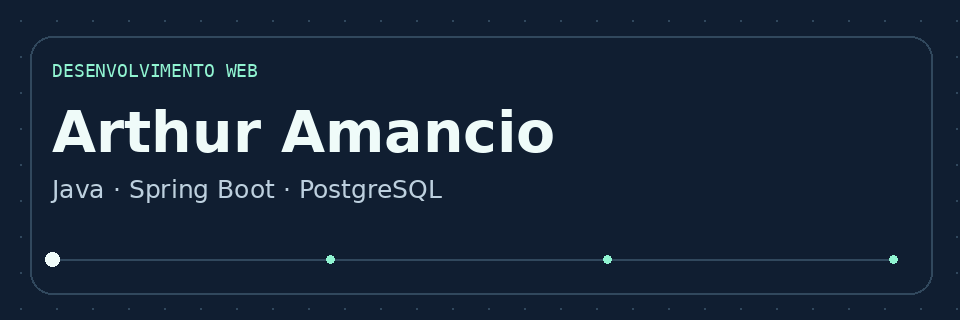
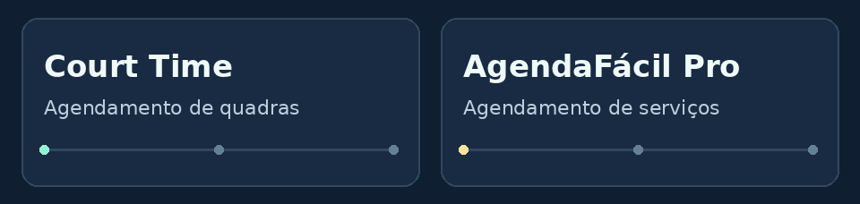

**Desenvolvedor Java em formação · Aplicações web · Suporte de TI**

Transformo processos de agendamento e gestão em aplicações web, com atenção às regras de negócio, aos dados e à experiência de quem usa.

[LinkedIn](https://www.linkedin.com/in/arthur-amancio-francisco/) · [Projetos](#projetos-em-destaque) · [Portfólio](https://arthur-amancio-portfolio.onrender.com/) · [Currículo em PDF](https://arthur-amancio-portfolio.onrender.com/assets/Arthur-Amancio-Curriculo.pdf) · [Código do portfólio](https://github.com/arthur-amancio/Portifolio)

## Projetos em destaque

### [Court Time — agendamento de quadras](https://github.com/arthur-amancio/CourtTime)

**TCC desenvolvido em equipe** para organizar o uso da quadra da ETEC, da solicitação do aluno à conferência na portaria.

- Jornada com quatro perfis: aluno, secretaria, administração e segurança.
- Participantes, formulário oficial em PDF, conferência documental e registro de contribuição presencial.
- Revalidação de disponibilidade na aprovação e testes de integração com PostgreSQL.

**Java 17 · Spring Boot · Thymeleaf · Spring Security · PostgreSQL · PDFBox**

[Estudo de caso](https://arthur-amancio-portfolio.onrender.com/#estudo-courttime) · [Código e execução local](https://github.com/arthur-amancio/CourtTime#readme)

Minhas contribuições documentadas incluem a apresentação técnica, o registro da revisão das regras e o ajuste nas orientações de assinatura. [Histórico das minhas alterações](https://github.com/arthur-amancio/CourtTime/commits?author=arthur-amancio)

### [AgendaFácil Pro — projeto individual](https://github.com/arthur-amancio/AgendaFacil)

Agendamento para profissionais de serviços: o cliente consulta a agenda pública e o estabelecimento administra os atendimentos em um painel protegido. Desenvolvido com Java, Spring Boot, Thymeleaf, PostgreSQL, Flyway e testes automatizados. **Em desenvolvimento.**

[Conhecer o projeto](https://arthur-amancio-portfolio.onrender.com/#detalhes-agenda) · [Execução e documentação](https://github.com/arthur-amancio/AgendaFacil#como-executar)

### Outros projetos

| Projeto | O que você encontra | Tecnologias |
|---|---|---|
| [FlowStock](https://github.com/arthur-amancio/ControleEstoque) | MVP de gestão multiempresa com estoque, produção e vendas; em evolução. | Java 21, Spring Boot, React, TypeScript, PostgreSQL |
| [Guia do Colaborador UB](https://github.com/arthur-amancio/Guia-Orienta-o-UB) | Tutorial por etapas para orientar o uso do Portal de Suporte; em revisão interna. | React, TypeScript, CSS |
| [Hospital-ERP](https://github.com/arthur-amancio/Hospital-ERP) | Estudo de cadastros e fluxos hospitalares com diferentes perfis de acesso; em revisão. | Java, Spring Boot, Thymeleaf, PostgreSQL |

## Sobre mim

Estudo Informática para Internet na **ETEC Prof. Armando José Farinazzo**, com conclusão prevista para dezembro de 2026. Na **Universidade Brasil**, atuo em suporte de TI com atendimento a usuários, diagnóstico de problemas de computadores e apoio à infraestrutura de rede.

Busco oportunidades em desenvolvimento de software com foco em Java.

## Tecnologias que utilizo nos projetos

| Área | Tecnologias |
|---|---|
| Backend | Java, Spring Boot, Spring MVC, Spring Security, Spring Data JPA |
| Banco de dados | PostgreSQL, MySQL, SQL |
| Interfaces | Thymeleaf, HTML, CSS, JavaScript; React e TypeScript em projetos específicos |
| Desenvolvimento e validação | Git, GitHub, Maven, JUnit, MockMvc, GitHub Actions |
| Infraestrutura de desenvolvimento | Docker e Docker Compose em projetos específicos |

Os repositórios incluem projetos acadêmicos e de portfólio em diferentes etapas. Os READMEs apresentam execução, funcionalidades e limitações de cada um.

## Contato

Para conversar sobre oportunidades em desenvolvimento e projetos: [LinkedIn](https://www.linkedin.com/in/arthur-amancio-francisco/) ou [arthurfrancisco2510@gmail.com](mailto:arthurfrancisco2510@gmail.com).
